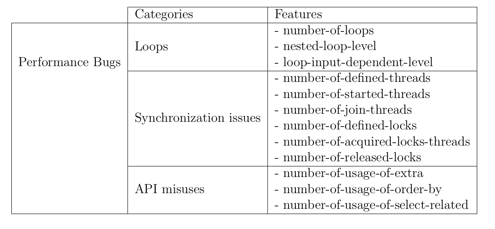
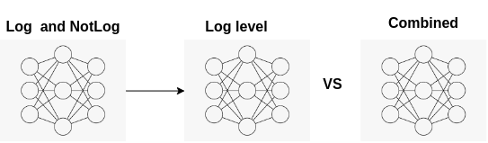
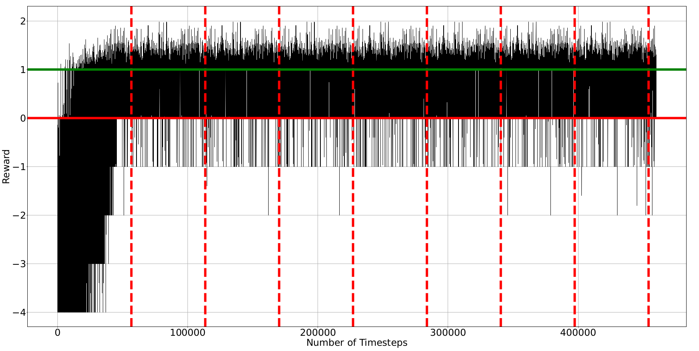
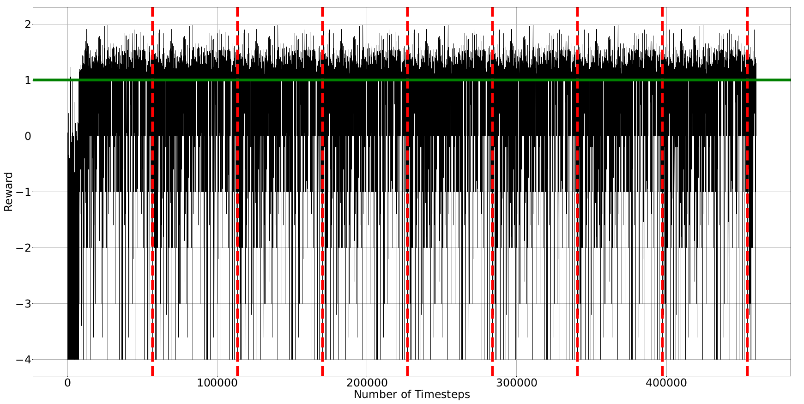
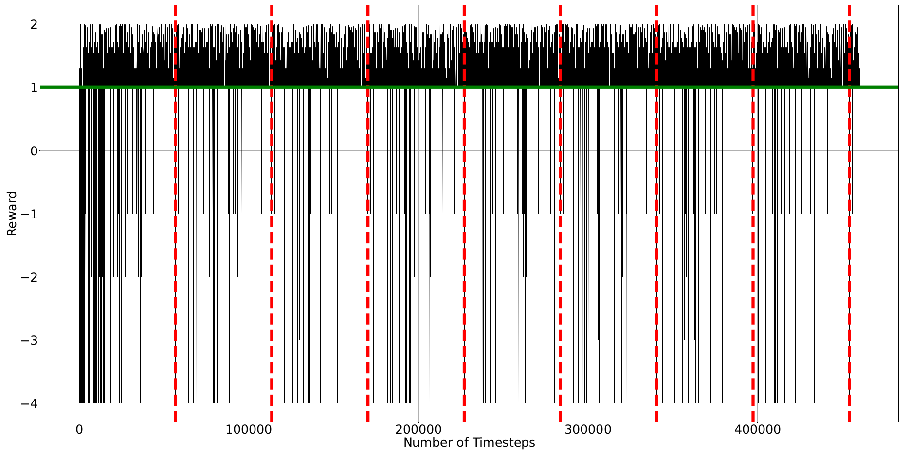

# Adaptive Logging System (ALS)

**Authors:** Amirmahdi Khosravi Tabrizi, Naser Ezzati-Jivan, and Francois Tetreault

A reinforcement learning–based framework that automatically recommends where and at what log level to place log statements in Python source code, with a focus on detecting performance bugs.

---

## About

The **Adaptive Logging System (ALS)** is a research project that applies reinforcement learning to solve a common challenge in software engineering: deciding *where* to place log statements and *which log level* to use. Poor logging practices lead to performance overhead or insufficient visibility during debugging and postmortem analysis.

ALS addresses this by:

- **Automatically recommending log placement** — using static code analysis to extract 12 features per function that capture performance-bug potential (Loops, Synchronization, and API Misuses).
- **Adapting to custom logging objectives** — trained RL agents (DQN, A2C, PPO1) learn policies tailored to the specified goal rather than following a one-size-fits-all heuristic.
- **Generalizing across projects** — validated on 17 diverse open-source Python projects from the Apache and Django ecosystems, demonstrating stable cross-project performance.

This work was developed in collaboration with **Ciena**, an industrial partner requiring adaptive, performance-aware logging for resource-constrained environments such as network routers.

| | |
|---|---|
| **Language** | Python |
| **ML Framework** | Stable Baselines 2 (TensorFlow 1.x) |
| **Algorithms** | DQN · A2C · PPO1 |
| **Domain** | Software Engineering / MLOps |
| **Focus** | Performance bug detection via intelligent log placement |

---

## Table of Contents

- [About](#about)
- [Overview](#overview)
- [System Architecture](#system-architecture)
- [Source Code Features](#source-code-features)
- [Reinforcement Learning Models](#reinforcement-learning-models)
- [Dataset](#dataset)
- [Project Structure](#project-structure)
- [Installation](#installation)
- [Usage](#usage)
- [Results](#results)
- [Paper Abstract](#paper-abstract)
- [Citation](#citation)

---

## Overview

The efficient management of software logs is crucial for software performance evaluation. Developers often struggle with deciding *where* to place log statements and *which log level* to use. Existing frameworks are limited by their inability to adapt to customized logging objectives and frequently show poor cross-project consistency.

The **Adaptive Logging System (ALS)** addresses these limitations by:

- Defining a **performance-oriented logging objective** centered on detecting three classes of performance bugs: **Loops**, **Synchronization**, and **API Misuses**.
- Extracting **12 static source code features** to characterize each function's performance-bug potential.
- Training **reinforcement learning agents** (DQN, A2C, PPO1) that learn to recommend log placements and log levels adapted to the specified objective.
- Demonstrating **stable cross-project performance** across 17 diverse open-source Python projects.

---

## System Architecture

The ALS pipeline consists of three main stages:

1. **Data Collection** (`web-scraping.ipynb`) — Python source files are scraped from Apache and Django open-source projects on GitHub.
2. **Feature Extraction** (`feature-extraction.ipynb`) — Static AST analysis extracts 12 features per function, producing a structured dataset.
3. **Model Training & Evaluation** (`model-implementation.ipynb`) — RL agents are trained on the extracted features and evaluated both within-project and cross-project.


The RL environment wraps the feature dataset: each step presents a function's feature vector as the **observation**, the agent selects a **log action** (log level or no-log), and a shaped **reward signal** reinforces correct log placement decisions.


---

## Source Code Features

ALS defines **12 static source code features** grouped into three performance-bug categories:

### 1. Loops (3 features)

| Feature | Description |
|---|---|
| `number_of_loops` | Total number of `for`/`while` loops inside the function |
| `nested_loop_level` | Depth of nested loops (e.g., 2 = doubly-nested loop present) |
| `loop_input_dependent_level` | Number of loops whose declaration uses input-dependent variables or calls to neighbor functions |

### 2. Synchronization (6 features)

These features count occurrences of Python threading primitives within each function:

| Feature | Description |
|---|---|
| `number_of_defined_threads` | Calls to `threading.Thread()` |
| `number_of_started_threads` | Calls to `Thread.start()` |
| `number_of_join_threads` | Calls to `Thread.join()` (excluding string `.join()`) |
| `number_of_defined_locks` | Calls to `threading.Lock()` |
| `number_of_acquired_locks_threads` | Calls to `Lock.acquire()` |
| `number_of_released_locks` | Calls to `Lock.release()` |

### 3. API Misuses (3 features)

Focused on Django ORM patterns that commonly cause performance regressions:

| Feature | Description |
|---|---|
| `number_of_usage_of_extra` | Uses of `.extra()` (complex sub-queries) |
| `number_of_usage_of_values_list` | Uses of `.values()` / `.values_list()` without field specification |
| `number_of_usage_of_select_related` | Uses of `.select_related()` (may cause excessive data retrieval) |



---

## Reinforcement Learning Models

ALS frames log placement as a **discrete action RL problem**:

- **Observation space:** A 12-dimensional feature vector representing one function.
- **Action space:** 6 discrete actions — `not_log`, `Trace`, `Debug`, `Info`, `Warn`, `IDK`.
- **Reward function:** Shaped reward based on sigmoid of feature values; penalizes missed logs or incorrect log levels; rewards correct placement proportionally to feature severity.



Three RL algorithms are compared:

| Algorithm | Description |
|---|---|
| **DQN** | Deep Q-Network — off-policy, value-based |
| **A2C** | Advantage Actor-Critic — on-policy, actor-critic |
| **PPO1** | Proximal Policy Optimization — on-policy, clipped surrogate objective |

All models are implemented using [Stable Baselines 2](https://stable-baselines.readthedocs.io/).

---

## Dataset

- **Projects:** 17 open-source Python projects from the Apache and Django ecosystems (see `projects-to-investigate/` for the full list).
- **Unit of analysis:** Individual Python functions extracted via AST parsing.
- **Files:** `code/data/dataframe_main.csv` (training), `code/data/dataframe_testing.csv` (evaluation).


Example projects included:

- Apache: Allura, Beam, CloudStack, IoTDB, Libcloud, Thrift, and others
- Django ecosystem projects

---

## Project Structure

```
Adaptive-Logging-System/
├── README.md
├── test.py                          # Example Python file with performance-bug patterns
├── Figures/                         # Diagrams and result plots
│   ├── system oveview.png
│   ├── features.png
│   ├── RL model.png
│   ├── DQN.png / A2C.png / PPO1.png
│   └── ...
├── projects-to-investigate/         # Raw source zips of investigated projects
└── code/
    ├── web-scraping.ipynb           # Stage 1: Data collection from GitHub
    ├── feature-extraction.ipynb     # Stage 2: AST-based feature extraction
    ├── model-implementation.ipynb   # Stage 3: RL model training & evaluation
    ├── data/
    │   ├── dataframe_main.csv       # Training dataset
    │   └── dataframe_testing.csv    # Test dataset
    ├── images/                      # Notebook figures
    ├── logs/                        # Training logs and evaluation results
    ├── *_model.zip                  # Saved trained models (DQN, A2C, PPO1)
    ├── *_rewards_list.pkl           # Reward histories per model
    └── projects-to-investigate/     # Extracted Python files for training/testing
```

---

## Installation

**Prerequisites:** Python 3.6+, Jupyter Notebook

```bash
# Clone the repository
git clone https://github.com/amirmahdiKhosravi/Adaptive-Logging-System.git
cd Adaptive-Logging-System

# Install dependencies
pip install stable-baselines[mpi]==2.10.2
pip install gym numpy pandas matplotlib
pip install astor requests PyGithub
```

> **Note:** Stable Baselines 2 requires TensorFlow 1.x. It is recommended to use a dedicated virtual environment.

---

## Usage

Run the notebooks in order:

### 1. Data Collection

Open and run `code/web-scraping.ipynb` to scrape Python source files from GitHub repositories.

### 2. Feature Extraction

Open and run `code/feature-extraction.ipynb` to parse source files, extract the 12 features per function, and produce `data/dataframe_main.csv` and `data/dataframe_testing.csv`.

### 3. Model Training & Evaluation

Open and run `code/model-implementation.ipynb` to:
- Train DQN, A2C, and PPO1 agents on the extracted features.
- Evaluate within-project and cross-project performance.
- Save trained models (`*_model.zip`) and reward histories (`*_rewards_list.pkl`).

---

## Results

ALS was trained for ~112,000 timesteps per model. Learning curves (moving average of rewards) for each algorithm are stored in `Figures/` and `code/`:

| Model | Within-Project | Cross-Project |
|---|---|---|
| DQN |  |  |
| A2C |  |  |
| PPO1 |  |  |

---

## Paper Abstract

The efficient management of software logs is crucial in software performance evaluation, enabling detailed examination of runtime information for postmortem analysis. Recognizing the importance of logs and the challenges developers face in making informed log-placement decisions, there is a clear need for a robust log-placement framework that supports developers. Existing frameworks, however, are limited by their inability to adapt to customized logging objectives, a concern highlighted by our industrial partner, Ciena, who required a system for their specific logging goals in resource-limited environments like routers. Moreover, these frameworks often show poor cross-project consistency. This study introduces a novel performance logging objective designed to uncover potential performance bugs, categorized into three classes — Loops, Synchronization, and API Misuses — and defines 12 source code features for their detection. We present the Adaptive Logging System (ALS), based on reinforcement learning, which adjusts to specified logging objectives, particularly for identifying performance bugs. This framework, not restricted to specific projects, demonstrates stable cross-project performance. Validating ALS's efficacy, it was trained and evaluated on Python source code from 17 diverse open-source projects within the Apache and Django ecosystems. Our findings suggest that ALS has the potential to significantly enhance current logging practices by providing a more targeted, efficient, and context-aware logging approach, particularly beneficial for our partner, Ciena who requires a flexible system that adapts to varied performance objectives and logging needs in their unique operational environments.

---

## Citation

If you use this work, please cite:

```
Amirmahdi Khosravi Tabrizi, Naser Ezzati-Jivan, and Francois Tetreault.
"Adaptive Logging System (ALS): A Reinforcement Learning Approach for Performance-Aware Log Placement."
```
